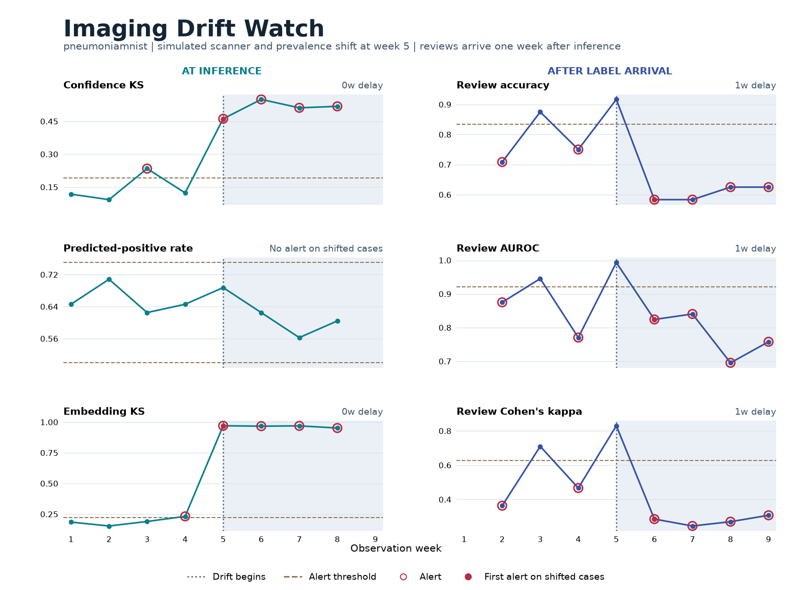

# Imaging Drift Watch

A Python CLI that trains a small CPU CNN on 28x28 chest X-rays and monitors the
frozen classifier through eight simulated deployment weeks. It writes a
Markdown report, machine-readable JSON, and a PNG timeline.

## Quickstart

Run from the repository root with Python 3.13. This example uses PowerShell.

```powershell
python -m venv .venv
.\.venv\Scripts\python.exe -m pip install -r requirements.txt
.\.venv\Scripts\python.exe imaging_drift_watch.py
```

Open `outputs/report.md`, `outputs/report.json`, or `outputs/timeline.png`.
The default run downloads [PneumoniaMNIST](https://medmnist.com/v2) into
`data/` on first use. If the download fails, the CLI reports the reason
and uses the bundled scikit-learn 8x8 digits dataset (odd versus even).
Use `--dataset digits` for an offline run or `--dataset pneumoniamnist` to
require the X-ray dataset. See `--help` for the seed, epoch, and output options.

## How the simulation works

1. Train the CNN on the official training split. Fit PCA and calibrate alert
   thresholds on a 60% positive reference sample from the validation split.
   Replay distinct cases from the test split in batches of 48.
2. Starting in week 5, apply gamma and contrast changes, blur, and noise to
   every image. At the same time, reduce the positive share from 29 of 48
   to 14 of 48 cases. Dataset labels control this sampling in the simulator.
3. At inference, compare maximum class confidence with the reference using
   the two-sample KS statistic, track the predicted-positive rate at a 0.5
   cutoff, and take the largest KS statistic across four PCA components of
   the 24-dimensional penultimate-layer embedding. These metrics use model
   outputs and embeddings only.
4. Release dataset labels for a random sample of 24 cases one week later.
   Compute accuracy, AUROC, and Cohen's kappa against these proxy reads.
   Week 9 receives the labels for week 8 and has no new inference batch.

Thresholds come from 400 bootstrap draws at the batch and review sample sizes.
KS alerts above the 95th percentile. The predicted-positive rate alerts
outside the central 95% interval. Review metrics alert below the 5th percentile.
Detection delay counts from week 5 to the observation week of the first alert
on shifted cases. An alert on a pre-drift batch can arrive in week 5 if it
depends on delayed labels.

## Measured results

Captured from `python imaging_drift_watch.py --out-dir example` on Windows
with Python 3.13 and the default seed of 42.

```text
Dataset: pneumoniamnist | seed 42 | CPU
Epoch 1/8 | train loss 0.3541
Epoch 2/8 | train loss 0.3120
Epoch 3/8 | train loss 0.2332
Epoch 4/8 | train loss 0.1811
Epoch 5/8 | train loss 0.1618
Epoch 6/8 | train loss 0.1519
Epoch 7/8 | train loss 0.1296
Epoch 8/8 | train loss 0.1323
Reference (n=300) | accuracy 0.923 | AUROC 0.975 | kappa 0.839 | predicted-positive 0.623
Drift starts week 5 | 48 cases/week | 24 reviews after 1 week
Confidence KS | threshold > 0.192 | week 5 (cases from week 5, value 0.462, delay 0w) | alerts on pre-drift cases: 3
Predicted-positive rate | threshold < 0.499 or > 0.750 | no alert on shifted cases | alerts on pre-drift cases: none
Embedding KS | threshold > 0.223 | week 5 (cases from week 5, value 0.970, delay 0w) | alerts on pre-drift cases: 4
Review accuracy | threshold < 0.833 | week 6 (cases from week 5, value 0.583, delay 1w) | alerts on pre-drift cases: 2, 4
Review AUROC | threshold < 0.921 | week 6 (cases from week 5, value 0.824, delay 1w) | alerts on pre-drift cases: 2, 4
Review Cohen's kappa | threshold < 0.628 | week 6 (cases from week 5, value 0.286, delay 1w) | alerts on pre-drift cases: 2, 4
Wrote example\report.md, example\report.json, and example\timeline.png
```

The confidence and embedding monitors flagged the first shifted batch.
Accuracy, AUROC, and kappa crossed their thresholds when that batch's review
sample arrived a week later. The predicted-positive rate stayed inside its
alert band through week 8, despite the drop in actual prevalence. Several
monitors also fired on pre-drift cases.



The [weekly report](example/report.md) and [JSON](example/report.json) include
all observations, threshold crossings, and the source week of each review.

## Limitations

This is a toy experiment with 28x28 images, one seed, and simultaneous,
simulated scanner and case-mix changes. The 24-case review samples are noisy,
and these per-monitor thresholds can produce false alerts across repeated
checks. Dataset annotations stand in for radiologist reads. This demo has no
clinical validation and is unsuitable for clinical use.

I train YOLO and RF-DETR detectors on Roboflow-labeled data for a robot-arm lab
at Drexel, and this demo explores how I could monitor a vision model after deployment.
