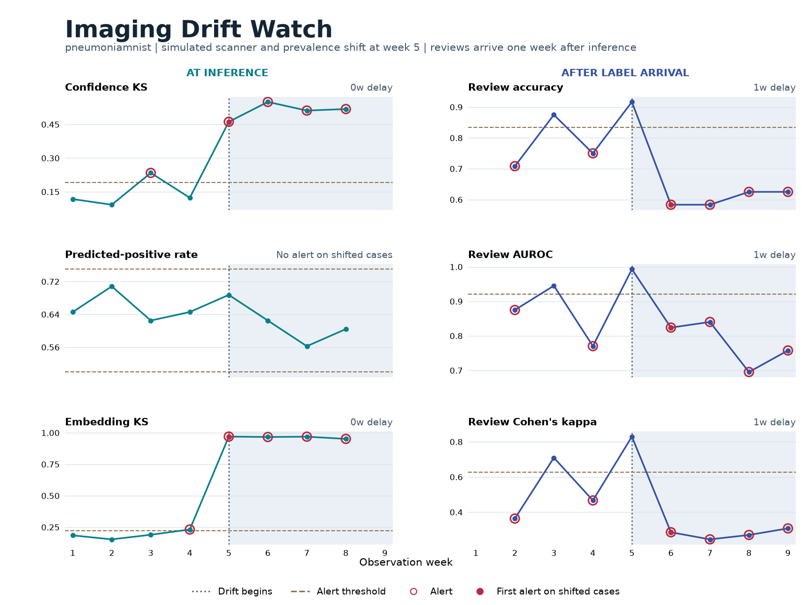

# Imaging Drift Watch run

Dataset: pneumoniamnist | seed: 42 | epochs: 8 | training cases: 4708

```text
Reference (n=300) | accuracy 0.923 | AUROC 0.975 | kappa 0.839 | predicted-positive 0.623
Drift starts week 5 | 48 cases/week | 24 reviews after 1 week
Confidence KS | threshold > 0.192 | week 5 (cases from week 5, value 0.462, delay 0w) | alerts on pre-drift cases: 3
Predicted-positive rate | threshold < 0.499 or > 0.750 | no alert on shifted cases | alerts on pre-drift cases: none
Embedding KS | threshold > 0.223 | week 5 (cases from week 5, value 0.970, delay 0w) | alerts on pre-drift cases: 4
Review accuracy | threshold < 0.833 | week 6 (cases from week 5, value 0.583, delay 1w) | alerts on pre-drift cases: 2, 4
Review AUROC | threshold < 0.921 | week 6 (cases from week 5, value 0.824, delay 1w) | alerts on pre-drift cases: 2, 4
Review Cohen's kappa | threshold < 0.628 | week 6 (cases from week 5, value 0.286, delay 1w) | alerts on pre-drift cases: 2, 4
```

Week is the time of observation. Review metrics refer to the listed case week. NA means a metric was unavailable. Strict threshold crossings trigger alerts. Alert decisions use full precision.

| Week | Confidence KS | Predicted-positive rate | Embedding KS | Review case week | Accuracy | AUROC | Kappa | Alerts |
| --- | --- | --- | --- | --- | --- | --- | --- | --- |
| 1 | 0.117 | 0.646 | 0.185 | NA | NA | NA | NA | None |
| 2 | 0.093 | 0.708 | 0.153 | 1 | 0.708 | 0.875 | 0.364 | Review accuracy, Review AUROC, Review Cohen's kappa |
| 3 | 0.234 | 0.625 | 0.190 | 2 | 0.875 | 0.945 | 0.710 | Confidence KS |
| 4 | 0.123 | 0.646 | 0.232 | 3 | 0.750 | 0.770 | 0.467 | Embedding KS, Review accuracy, Review AUROC, Review Cohen's kappa |
| 5 | 0.462 | 0.688 | 0.970 | 4 | 0.917 | 0.993 | 0.830 | Confidence KS, Embedding KS |
| 6 | 0.550 | 0.625 | 0.967 | 5 | 0.583 | 0.824 | 0.286 | Confidence KS, Embedding KS, Review accuracy, Review AUROC, Review Cohen's kappa |
| 7 | 0.512 | 0.562 | 0.969 | 6 | 0.583 | 0.840 | 0.245 | Confidence KS, Embedding KS, Review accuracy, Review AUROC, Review Cohen's kappa |
| 8 | 0.518 | 0.604 | 0.952 | 7 | 0.625 | 0.695 | 0.270 | Confidence KS, Embedding KS, Review accuracy, Review AUROC, Review Cohen's kappa |
| 9 | NA | NA | NA | 8 | 0.625 | 0.758 | 0.308 | Review accuracy, Review AUROC, Review Cohen's kappa |


